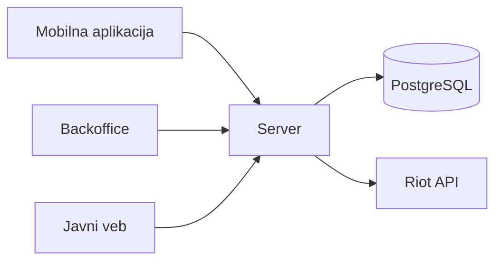

# TFT Insights

Aplikacija za Teamfight Tactics koja omogućava pregled statistike šampiona i predmeta iz odigranih mečeva, istraživanje njihovih kombinacija i kreiranje timskih postava. Korisnici mogu da čuvaju i menjaju svoje postave bez interneta, pretražuju objavljene taktike i sačuvaju tuđu taktiku kao osnovu za svoju. Taktike i statistika dostupne su i na javnom vebu, dok kreatori objavljuju svoje taktike, a administratori upravljaju sadržajem i ovlašćenjima kroz zajedničku backoffice aplikaciju.

## Tim

| Ime i prezime | Broj indeksa | GitHub nalog |
| --- | --- | --- |
| Ognjen Marković | 77/24 SI | [@MarkisKV](https://github.com/MarkisKV) |
| Filip Čobeljić | 78/24 SI | [@FilipCobeljic78-24si](https://github.com/FilipCobeljic78-24si) |

## Zahtevi za temu

1. **Uloge.** Korisnik (User) pravi i čuva lične postave, pregleda statistiku i preuzima objavljene taktike. Kreator ima iste mogućnosti, a kroz backoffice dodatno kreira, uređuje i samostalno objavljuje svoje taktike. Administrator kroz isti backoffice dodeljuje i oduzima kreatorska ovlašćenja i moderira sve javne taktike. Pregled javnog sadržaja i čuvanje ličnih postava na uređaju ne zahtevaju nalog.
2. **Stanja.** Taktika ima četiri stanja: nacrt, objavljena, sakrivena i arhivirana. Kreator objavljuje svoj nacrt i može da arhivira svoju taktiku. Administrator može da sakrije objavljenu taktiku uz obrazloženje i da je ponovo učini javnom nakon ispravki. Sakrivenu taktiku kreator može da uređuje, ali ne može samostalno da je ponovo objavi. Arhivirana taktika više nije javno dostupna.
3. **Pravila.** Kreator uređuje i objavljuje samo svoje taktike. Postava ne može imati dva šampiona na istom polju niti više od tri predmeta po šampionu. Objavljivanje zahteva važeće kreatorsko ovlašćenje koje dodeljuje administrator. Ako drugi korisnik sa administratorskim ovlašćenjima sakrije taktiku, njen autor ne može ponovnim objavljivanjem da zaobiđe tu odluku; vraćanje u javni prikaz zahteva administratorsku odluku. Time dostupnost taktike zavisi i od podataka koje unosi drugi korisnik, a server konačno proverava ovlašćenja, pravila i dozvoljene promene stanja.
4. **Rad bez mreže.** Korisnik kreira, menja, preimenuje i briše lične postave i dodeljuje predmete šampionima bez interneta. Promene se čuvaju na uređaju i ostaju dostupne nakon ponovnog pokretanja aplikacije. Kreator može, kada postoji veza, da prenese sačuvanu postavu u serverski nacrt i nastavi uređivanje u backoffice aplikaciji.
5. **Posao za osoblje.** Kreatori u backoffice aplikaciji rade sa tabelom svojih taktika, pretragom i filtriranjem po stanju, uređuju raspored šampiona, predmete i opis i objavljuju sadržaj. Administratori imaju pregled svih taktika, mogućnost skrivanja sadržaja uz obrazloženje i upravljanje kreatorskim ovlašćenjima. Pregled većeg broja taktika i uređivanje postave i opisa prilagođeni su većem ekranu.
6. **Javni sadržaj.** Objavljene taktike sa opisima, postavama i preporučenim predmetima dostupne su bez prijave, na zasebnim stranicama koje pretraživači mogu da indeksiraju. Javni pregled statistike omogućava filtriranje po šampionu, predmetu i broju zvezdica, uz prikaz broja posmatranja, prosečnog plasmana i učestalosti završavanja među prva četiri ili na prvom mestu.

## Delovi sistema

| Deo | Korisnici | Tehnologija | Platforme |
| --- | --- | --- | --- |
| Mobilna aplikacija | posetioci, registrovani korisnici | Flutter | Android |
| Backoffice | kreatori, administratori | Flutter | Windows, veb |
| Javni veb | svi posetioci | Jaspr | pregledač |
| Server | ostali delovi sistema | Relic, PostgreSQL | Linux |
| Domenski paket | svi delovi sistema | Dart | sve |

Svi delovi koriste isti domenski paket, u kome su modeli, stanja taktike i poslovna pravila. Server čuva zajedničke podatke i ponovo proverava pravila i ovlašćenja. Lične postave čuvaju se lokalno u mobilnoj aplikaciji.

Server preuzima podatke o završenim mečevima preko Riot API-ja i iz njih izračunava statistiku šampiona i predmeta. Početna verzija koristi ograničen uzorak rangiranih mečeva za jedan set i verziju igre. Uz statistiku se prikazuju veličina uzorka i period prikupljanja podataka.



## Stanje projekta

Završena je prva kontrolna tačka: mobilna aplikacija i backoffice rade nad istim domenskim paketom, sa podacima u memoriji. Server, prijava i rad bez mreže dolaze u narednim tačkama.

- **Mobilna aplikacija** (Android), kao kreator Marko, koji ima sve mogućnosti korisnika i uz to vidi svoje taktike u svim stanjima:
  - **Kompozicije:** javna tier lista patcha 18.5c (S, A, B, C, Situaciona) sa objavljenim taktikama svih kreatora.
  - **Moje kompozicije:** Markove objavljene taktike, nacrti i lične postave; arhivirane su iza prekidača u zaglavlju.
  - Detalj taktike sa varijantama, ranom i kasnom tablom, fleksibilnim jedinicama, prioritetom predmeta i savetima po fazama, i arhiviranje uz potvrdu.
  - Uređivač ličnih postava koji proverava pravila (najviše tri predmeta po šampionu, jedan šampion po polju) i javlja greške na srpskom.
  - Povlačenje za osvežavanje; u razvojnoj verziji meni za simulaciju greške i praznog odgovora.
- **Backoffice** (Windows i veb), kao administrator Ana:
  - **Taktike:** tabela svih taktika sa filterom po stanju i po tieru, pretragom po naslovu i autoru i bočnim panelom; skrivanje uz obrazloženje i vraćanje u javni prikaz.
  - **Uređivanje:** naslov, opis i, za svaku varijantu, rana i kasna tabla (šampion, zvezdice i do tri predmeta po polju; jedinice se prevlače po tabli), fleksibilne jedinice, prioritet predmeta i saveti. Kasna tabla ne sme da ostane prazna.
  - **Tier lista:** samo administrator premešta objavljenu taktiku u drugi tier ili je skida sa liste.
  - Rad sa tastaturom (↑ ↓, H, R, E, Esc); adresa čuva filtere, pretragu i izabranu taktiku, a u uskom prozoru tabela postaje lista sa panelom ispod.
  - Kreiranje i objavljivanje taktika kao kreator i dodela kreatorskih ovlašćenja dolaze sa prijavom, kada backoffice dobije više korisnika; pravila objavljivanja već su u domenskom paketu.
- **Domenski paket:** stanja taktike i dozvoljeni prelazi, pravila pristupa (autor uređuje svoje taktike, administrator sve, a taktiku koju je administrator sakrio autor ne može ponovo da objavi), izračunavanje nad listom svih taktika koje određuje šta ko vidi i šta je na tier listi, tako da sakrivena taktika nestaje iz javnog prikaza, pravila postave i pravilo da svaka taktika ima postavu.

### Pokretanje

U korenu repozitorijuma:

```
flutter pub get
```

Mobilna aplikacija se pokreće sa `flutter run` u `apps/mobile`, a backoffice sa `flutter run -d windows` ili `flutter run -d chrome` u `apps/backoffice`. Testovi se pokreću sa `dart test` u paketima i `flutter test` u aplikacijama. Ikonice šampiona i predmeta nisu deo repozitorijuma, pa aplikacije bez njih prikazuju imena.
