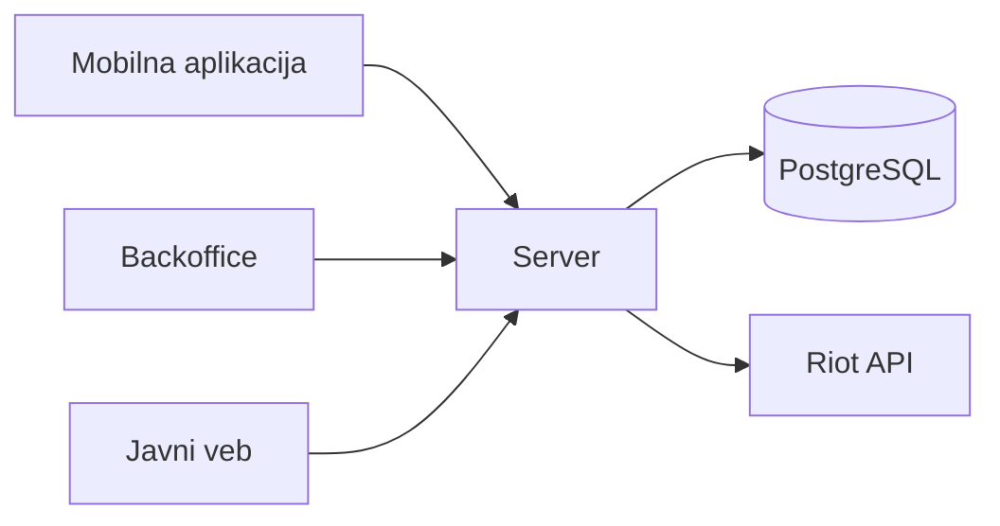

# TFT Insights

Aplikacija za Teamfight Tactics koja omogućava pregled statistike šampiona i predmeta iz odigranih mečeva, istraživanje njihovih kombinacija i kreiranje timskih postava. Korisnici mogu da čuvaju i menjaju svoje postave bez interneta, pretražuju objavljene taktike i sačuvaju tuđu taktiku kao osnovu za svoju. Taktike i statistika dostupne su i na javnom vebu, dok kreatori objavljuju svoje taktike, a administratori upravljaju sadržajem i ovlašćenjima kroz zajedničku backoffice aplikaciju.

## Tim

| Ime i prezime | Broj indeksa | GitHub nalog |
| --- | --- | --- |
| Ognjen Marković | 77/24 SI | [@MarkisKV](https://github.com/MarkisKV) |
| Filip Čobeljić | 78/24 SI | [@FilipCobeljic78-24si](https://github.com/FilipCobeljic78-24si) |

## Zahtevi za temu

1. **Uloge.** Korisnik (User) u mobilnoj aplikaciji pravi i čuva lične postave, pregleda statistiku i preuzima objavljene taktike. Kreator radi u obe aplikacije: u mobilnoj ima sve mogućnosti korisnika i uz to objavljuje i arhivira svoje taktike, a u backoffice-u radi sa tabelom svojih taktika, uređuje ih, objavljuje i arhivira. Administrator radi u backoffice-u: dodeljuje i oduzima kreatorska ovlašćenja, moderira sve javne taktike i raspoređuje ih po tier listi. Pregled javnog sadržaja i čuvanje ličnih postava na uređaju ne zahtevaju nalog.
2. **Stanja.** Taktika ima četiri stanja: nacrt, objavljena, sakrivena i arhivirana. Kreator objavljuje svoj nacrt i može da arhivira svoju taktiku. Administrator može da sakrije objavljenu taktiku uz obrazloženje i da je ponovo učini javnom nakon ispravki. Sakrivenu taktiku kreator može da uređuje, ali ne može samostalno da je ponovo objavi. Arhivirana taktika više nije javno dostupna.
3. **Pravila.** Kreator uređuje i objavljuje samo svoje taktike. Postava ne može imati dva šampiona na istom polju niti više od tri predmeta po šampionu. Objavljivanje zahteva važeće kreatorsko ovlašćenje koje dodeljuje administrator. Ako administrator sakrije taktiku, njen autor ne može ponovnim objavljivanjem da zaobiđe tu odluku; vraćanje u javni prikaz zahteva administratorsku odluku. Tier S na tier listi patcha prima najviše tri kompozicije. Ovo pravilo zavisi od rasporeda koji prave i drugi administratori, pa o njemu konačno odlučuje server: kada dva administratora istovremeno pokušaju da zauzmu poslednje mesto, prolazi samo jedan, a drugi dobija poruku da je tier pun. Server konačno proverava i ovlašćenja, pravila i dozvoljene promene stanja.
4. **Rad bez mreže.** Korisnik kreira, menja, preimenuje i briše lične postave i dodeljuje predmete šampionima bez interneta. Promene se čuvaju na uređaju i ostaju dostupne nakon ponovnog pokretanja aplikacije. Kreator može, kada postoji veza, da prenese sačuvanu postavu u serverski nacrt i nastavi uređivanje u backoffice aplikaciji.
5. **Posao za osoblje.** Kreatori u backoffice aplikaciji rade sa tabelom svojih taktika, pretragom i filtriranjem po stanju, uređuju raspored šampiona, predmete i opis i objavljuju i arhiviraju svoje taktike. Administratori imaju pregled svih taktika, mogućnost skrivanja sadržaja uz obrazloženje, raspoređivanje objavljenih taktika po tier listi i upravljanje kreatorskim ovlašćenjima. Pregled većeg broja taktika i uređivanje postave i opisa prilagođeni su većem ekranu.
6. **Javni sadržaj.** Objavljene taktike sa opisima, postavama i preporučenim predmetima dostupne su bez prijave, na zasebnim stranicama koje pretraživači mogu da indeksiraju. Javni pregled statistike omogućava filtriranje po šampionu, predmetu i broju zvezdica, uz prikaz broja posmatranja, prosečnog plasmana i učestalosti završavanja među prva četiri ili na prvom mestu.

## Delovi sistema

| Deo | Korisnici | Tehnologija | Platforme |
| --- | --- | --- | --- |
| Mobilna aplikacija | posetioci, korisnici, kreatori | Flutter | Android |
| Backoffice | kreatori, administratori | Flutter | Windows, veb |
| Javni veb | svi posetioci | Jaspr | pregledač |
| Server | ostali delovi sistema | Relic, PostgreSQL | Linux |
| Domenski paket | svi delovi sistema | Dart | sve |

Svi delovi koriste isti domenski paket, u kome su modeli, stanja taktike i poslovna pravila. Server čuva zajedničke podatke i ponovo proverava pravila i ovlašćenja. Lične postave čuvaju se lokalno u mobilnoj aplikaciji.

Server preuzima podatke o završenim mečevima preko Riot API-ja i iz njih izračunava statistiku šampiona i predmeta. Početna verzija koristi ograničen uzorak rangiranih mečeva za jedan set i verziju igre. Uz statistiku se prikazuju veličina uzorka i period prikupljanja podataka.



## Stanje projekta

Završena je druga kontrolna tačka: mobilna aplikacija i backoffice rade nad serverom, sa prijavom i ulogama, a server ponovo proverava ista pravila iz domenskog paketa. Rad bez mreže, javni veb i statistika iz Riot API-ja dolaze u narednim tačkama.

- **Server** (Relic i PostgreSQL, podiže se sa Docker Compose): čuva taktike, tier listu patcha 18.5c, katalog šampiona i predmeta i naloge. Svaki poziv koji menja podatke ide kroz iste slučajeve korišćenja kao u aplikacijama, a pozivaoca zna samo iz prijave koju je sam izdao.
- **Mobilna aplikacija** (Android):
  - **Kompozicije:** javna tier lista patcha 18.5c (S, A, B, C, Situaciona) sa objavljenim taktikama svih kreatora; dostupna i bez prijave, kao i detalj objavljene taktike.
  - **Moje kompozicije:** posle prijave Objavljene i Nacrti, a arhivirane iza prekidača u zaglavlju. Bez prijave ekran poziva na prijavu.
  - Detalj taktike sa varijantama, ranom i kasnom tablom, fleksibilnim jedinicama, prioritetom predmeta i savetima po fazama; arhiviranje svoje taktike uz potvrdu, a tuđa objavljena taktika može da se sačuva kao nacrt.
  - Uređivač nacrta sa tablom na kojoj se šampioni postavljaju i prevlače; proverava pravila i javlja greške na srpskom.
  - Prijava ostaje posle restarta (Keystore), ističe posle vremena iz podešavanja servera i briše se odjavom. Administrator ne može da se prijavi u mobilnu aplikaciju.
- **Backoffice** (Windows i veb), posle prijave kreatora ili administratora:
  - **Administrator:** tabela svih taktika sa filterom po stanju i po tieru, pretragom i bočnim panelom; skrivanje uz obrazloženje, vraćanje u javni prikaz, uređivanje i raspoređivanje po tier listi.
  - **Kreator:** tabela samo njegovih taktika u svim stanjima; uređivanje, objavljivanje i arhiviranje.
  - Osveži i F5 ponovo učitavaju podatke, pa se promena iz mobilne aplikacije vidi posle osvežavanja. Korisnik mobilne aplikacije ne može da se prijavi u backoffice.
- **Pravilo o kome odlučuje server:** tier S prima najviše tri kompozicije. Server ga proverava u transakciji koja zaključa red patcha, pa od dva istovremena pokušaja prolazi samo jedan. Drugi dobija poruku „Tier S je pun (najviše 3 kompozicije).“ i ponovo učitan raspored.

### Zavisno od teme

| Pitanje | Naš izbor | Odbačeno |
| --- | --- | --- |
| Vrsta pravila | Ograničen broj: tier S prima najviše 3 kompozicije | Jedan prelaz iz stanja (sakrivanje protiv arhiviranja), koji ostaje kao dodatna zaštita |
| Ko čuva pravilo | Server: transakcija zaključa red patcha (`FOR UPDATE`) i poziva isti `placeTactic` iz domena | Okidač ili ograničenje u bazi (pravilo dvaput, van domena); brava u memoriji servera; provera bez brave |
| Šta vidi zakasneli | 409 `tier-full` sa granicom, poruka „Tier S je pun (najviše 3 kompozicije).“ i ponovo učitan raspored | Tiho prepisivanje; izbacivanje najstarije kompozicije iz S |
| Šta vidi koja uloga | Bez prijave i korisnik: objavljene; kreator: i svoje; administrator: sve | Sve svima, uz filtriranje na klijentu |
| Vreme i stanja na mreži | ISO-8601 u UTC; stanje kao objekat sa `kind` i podacima | Unix sekunde; stanje kao goli string |
| Deo velike liste | Cela lista (oko 30 taktika) | `offset` / `limit`, koji dolazi sa javnim vebom |
| Tuđa promena | Osvežavanje (povlačenje, Osveži i F5, posle svake akcije) | WebSocket ili SSE |
| Fotografije i fajlovi | Nema ih; ikonice su lokalne | — |
| Pregledač | CORS i httpOnly cookie na serveru | Token u `localStorage` |
| Sesija | Potpisan JWT; odjava briše token i cookie, a token ističe posle `SESSION_TTL_MINUTES` | Tabela sesija sa opozivom |
| Bez prijave | Kompozicije i detalj objavljene taktike | Prijava za sve |
| Ko menja tuđi zapis | Administrator (sakriva, vraća, raspoređuje i uređuje dok taktika nije arhivirana); kreator samo svoje | Kreatori menjaju i tuđe taktike |

## Pokretanje

Potrebni su Docker (Docker Desktop na Windows-u i macOS-u) i Flutter 3.47.

### Baza i server

Iz korena repozitorijuma:

```sh
cp .env.example .env    # Windows: copy .env.example .env
docker compose up -d --build
```

`compose.yaml` podiže tri servisa:

| Servis | Šta radi | Adresa |
| --- | --- | --- |
| `db` | PostgreSQL 17 | `127.0.0.1:5436` |
| `migrate` | dbmate primeni migracije iz `apps/server/migrations`, pa izlazi | — |
| `server` | server u Dartu na Relic-u, slika iz `apps/server/Dockerfile` | http://localhost:8080 |

Lozinka baze, `DEMO_PASSWORD`, `JWT_SECRET` i portovi su u `.env`, koji nije u git-u. Ako je port zauzet, promenite ga u `.env`: `POSTGRES_PORT` (i isti port u `DATABASE_URL`) ili `SERVER_PORT` (aplikacije tada pokrenite sa `--dart-define=SERVER_URL=http://localhost:<port>`). Kada je baza prazna, server upisuje početne podatke: 30 taktika, tier listu patcha 18.5c, katalog i naloge.

Provera: `docker compose ps -a` (servis `migrate` je `Exited (0)`) i `curl localhost:8080/health` (odgovor `ok`; u PowerShell-u `curl.exe`).

| Komanda | Šta radi |
| --- | --- |
| `docker compose logs server` | ispis servera; `logs migrate` za migracije |
| `docker compose up -d --build server` | nova slika servera posle izmene u `apps/server` ili u paketima |
| `docker compose down` | gasi sistem, podaci ostaju |
| `docker compose down -v` | gasi sistem i briše bazu; sledeći `up -d` kreće od nule |

SQL iz terminala: `docker compose exec db psql -U tft -d tft_insights`.

Server bez kontejnera, za debugger i brži restart:

```sh
docker compose stop server
cd apps/server
dart run bin/server.dart    # Ctrl+C zaustavlja
```

Testovi servera traže pokrenutu bazu i rade nad posebnom bazom `tft_insights_test`: u `apps/server` pokrenuti `dart test`.

### Aplikacije

Aplikacije rade nad serverom. Android emulator ga nalazi na `10.0.2.2:8080`, a telefon preko USB-a uz `adb reverse tcp:8080 tcp:8080` i `flutter run --dart-define=SERVER_URL=http://localhost:8080` (na mreži: `SERVER_URL=http://<IP računara>:8080`). Pregledač sme da zove server samo sa adrese iz `CORS_ORIGINS` u `.env`; `.env.example` dozvoljava backoffice (`http://localhost:8081`).

U korenu repozitorijuma `flutter pub get`, pa svaka aplikacija u svom terminalu:

```sh
cd apps/mobile
flutter run
```

```sh
cd apps/backoffice
flutter run -d windows    # ili -d chrome --web-port 8081
```

Testovi se pokreću sa `dart test` u paketima i `flutter test` u aplikacijama. Ikonice šampiona i predmeta nisu deo repozitorijuma, pa aplikacije bez njih prikazuju imena.

### Demo nalozi

Lozinka za sve naloge je vrednost `DEMO_PASSWORD` iz `.env` (`tft-demo`).

| Nalog | Ime | Uloga | Aplikacija |
| --- | --- | --- | --- |
| `korisnik1`, `korisnik2` | Petar, Mina | korisnik | mobilna |
| `marko`, `tftinsights`, `luka`, `jovana` | Marko, TFT Insights, Luka, Jovana | kreator | mobilna i backoffice |
| `ana`, `admin2` | Ana, Ivana | administrator | backoffice |
