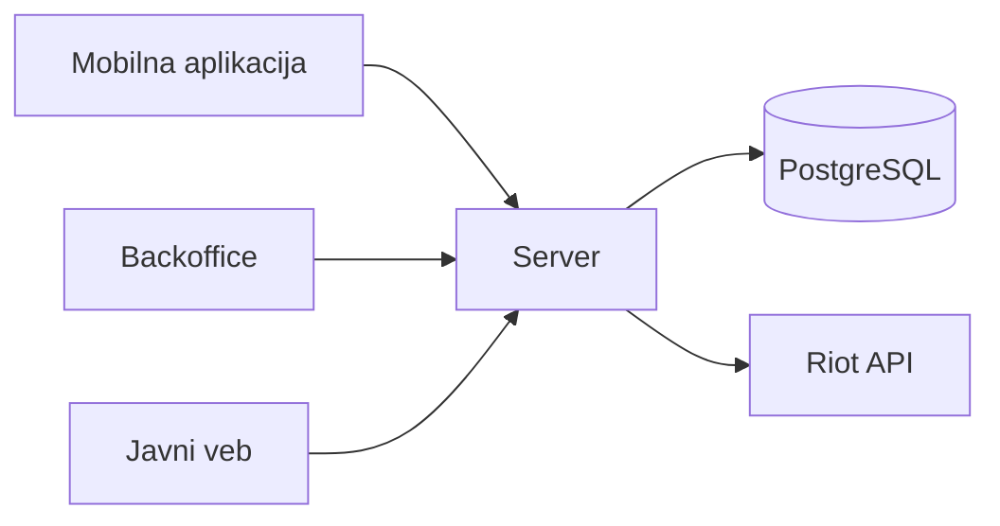

# TFT Insights

Aplikacija za Teamfight Tactics koja omogućava pregled statistike šampiona i predmeta iz odigranih mečeva, istraživanje njihovih kombinacija i kreiranje timskih postava. Korisnici mogu da čuvaju i menjaju svoje postave bez interneta, pretražuju objavljene taktike i sačuvaju tuđu taktiku kao osnovu za svoju. Taktike i statistika dostupne su i na javnom vebu, dok kreatori objavljuju svoje taktike, a administratori upravljaju sadržajem i ovlašćenjima kroz zajedničku backoffice aplikaciju.

## Tim

| Ime i prezime | Broj indeksa | GitHub nalog |
| --- | --- | --- |
| Ognjen Marković | 77/24 SI | [@MarkisKV](https://github.com/MarkisKV) |
| Filip Čobeljić | 78/24 SI | [@FilipCobeljic78-24si](https://github.com/FilipCobeljic78-24si) |

## Zahtevi za temu

1. **Uloge.** Korisnik (User) pravi i čuva lične postave, pregleda statistiku i preuzima objavljene taktike. Kreator ima iste mogućnosti, a kroz backoffice dodatno kreira, uređuje i samostalno objavljuje svoje taktike. Administrator kroz isti backoffice dodeljuje i oduzima kreatorska ovlašćenja i moderira sve javne taktike. Pregled javnog sadržaja i čuvanje ličnih postava na uređaju ne zahtevaju nalog.
2. **Stanja.** Taktika ima četiri stanja: nacrt, objavljena, sakrivena i arhivirana. Kreator objavljuje svoj nacrt i može da arhivira svoju taktiku. Administrator može da sakrije objavljenu taktiku uz obrazloženje i da je ponovo učini javnom nakon ispravki. Sakrivenu taktiku kreator može da uređuje, ali ne može samostalno da je ponovo objavi. Arhivirana taktika više nije javno dostupna.
3. **Pravila.** Kreator uređuje i objavljuje samo svoje taktike. Postava ne može imati dva šampiona na istom polju niti više od tri predmeta po šampionu. Objavljivanje zahteva važeće kreatorsko ovlašćenje koje dodeljuje administrator. Ako drugi korisnik sa administratorskim ovlašćenjima sakrije taktiku, njen autor ne može ponovnim objavljivanjem da zaobiđe tu odluku; vraćanje u javni prikaz zahteva administratorsku odluku. Time dostupnost taktike zavisi i od podataka koje unosi drugi korisnik, a server konačno proverava ovlašćenja, pravila i dozvoljene promene stanja.
4. **Rad bez mreže.** Korisnik kreira, menja, preimenuje i briše lične postave i dodeljuje predmete šampionima bez interneta. Promene se čuvaju na uređaju i ostaju dostupne nakon ponovnog pokretanja aplikacije. Kreator može, kada postoji veza, da prenese sačuvanu postavu u serverski nacrt i nastavi uređivanje u backoffice aplikaciji.
5. **Posao za osoblje.** Kreatori u backoffice aplikaciji rade sa tabelom svojih taktika, pretragom i filtriranjem po stanju, uređuju raspored šampiona, predmete i opis i objavljuju sadržaj. Administratori imaju pregled svih taktika, mogućnost skrivanja sadržaja uz obrazloženje i upravljanje kreatorskim ovlašćenjima. Pregled većeg broja taktika i uređivanje postave i opisa prilagođeni su većem ekranu.
6. **Javni sadržaj.** Objavljene taktike sa opisima, postavama i preporučenim predmetima dostupne su bez prijave, na zasebnim stranicama koje pretraživači mogu da indeksiraju. Javni pregled statistike omogućava filtriranje po šampionu, predmetu i broju zvezdica, uz prikaz broja posmatranja, prosečnog plasmana i učestalosti završavanja među prva četiri ili na prvom mestu.

## Delovi sistema

| Deo | Korisnici | Tehnologija | Platforme |
| --- | --- | --- | --- |
| Mobilna aplikacija | posetioci, registrovani korisnici | Flutter | Android |
| Backoffice | kreatori, administratori | Flutter | Windows, veb |
| Javni veb | svi posetioci | Jaspr | pregledač |
| Server | ostali delovi sistema | Relic, PostgreSQL | Linux |
| Domenski paket | svi delovi sistema | Dart | sve |

Svi delovi koriste isti domenski paket, u kome su modeli, stanja taktike i poslovna pravila. Server čuva zajedničke podatke i ponovo proverava pravila i ovlašćenja. Lične postave čuvaju se lokalno u mobilnoj aplikaciji.

Server preuzima podatke o završenim mečevima preko Riot API-ja i iz njih izračunava statistiku šampiona i predmeta. Početna verzija koristi ograničen uzorak rangiranih mečeva za jedan set i verziju igre. Uz statistiku se prikazuju veličina uzorka i period prikupljanja podataka.

## Stanje projekta

Definisan je početni obim sistema.